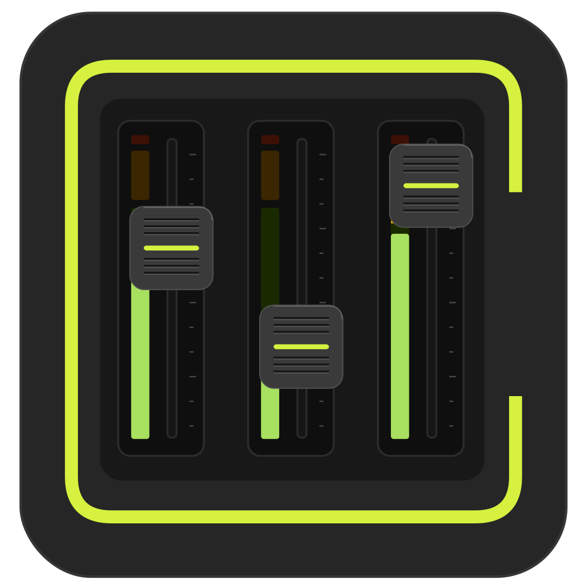

  

<h1 align="center">OpenFader</h1>

The best mixing app: the best UI, with wide support for all mixers.

OpenFader is an open mixing-station alternative. Native Flutter app in `apps/app`, DSP and engine in `crates/`. Supported today: Behringer X-Air series and Mackie DL32S, with more desks on the way. UI inspired by Mackie Master Fader.

## Dev setup

- Flutter 3.47.7: `export PATH="$HOME/flutter-3.47/bin:$PATH"`, then `flutter pub get` in `apps/app`.
- Rust stable workspace at the repo root: `cargo test --workspace --locked`.
- Node 24 for `node scripts/sync-version.mjs --check`.
- Checks before pushing: `flutter analyze` in `apps/app`, plus `cargo check`, `cargo clippy --workspace --all-targets --locked -- -D warnings`, and `cargo test --workspace --locked`.

## License

GPL-3.0-or-later, see `LICENSE`.
