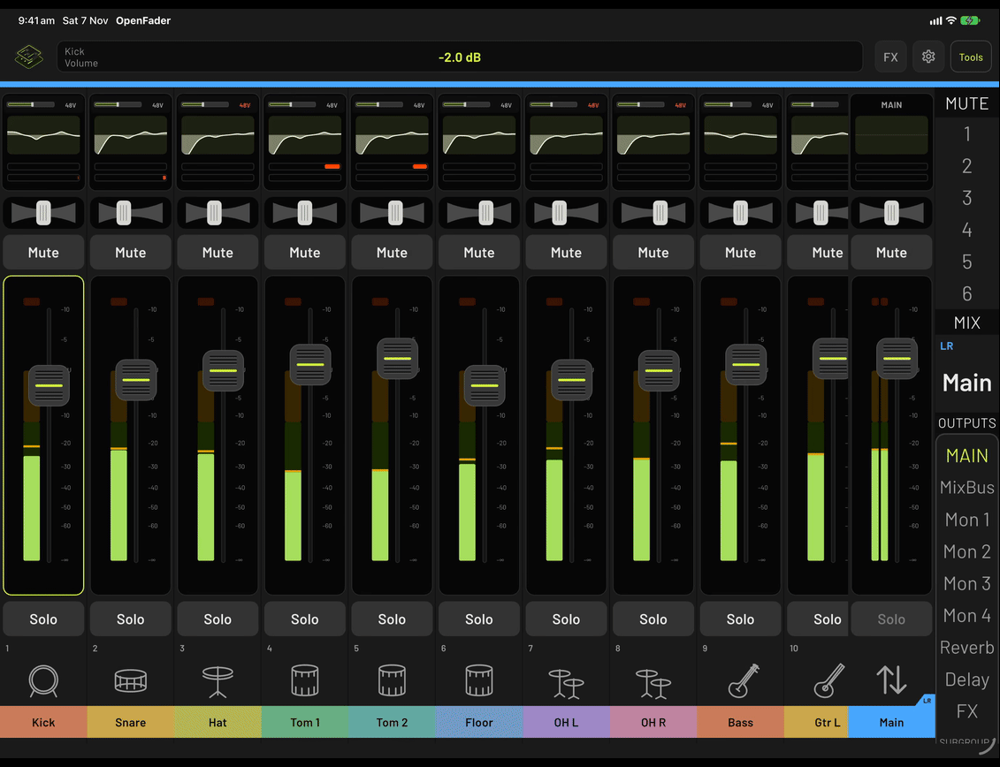
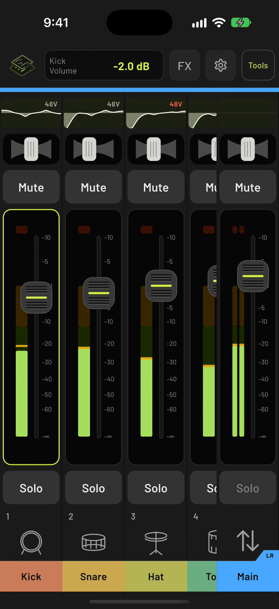

  

<h1 align="center">OpenFader</h1>

One app to control your digital mixers.

Currently supporting Behringer X-Air series and Mackie DL32S, with more consoles coming soon!.

  
  

## License

GPL-3.0. See [LICENSE](LICENSE).
