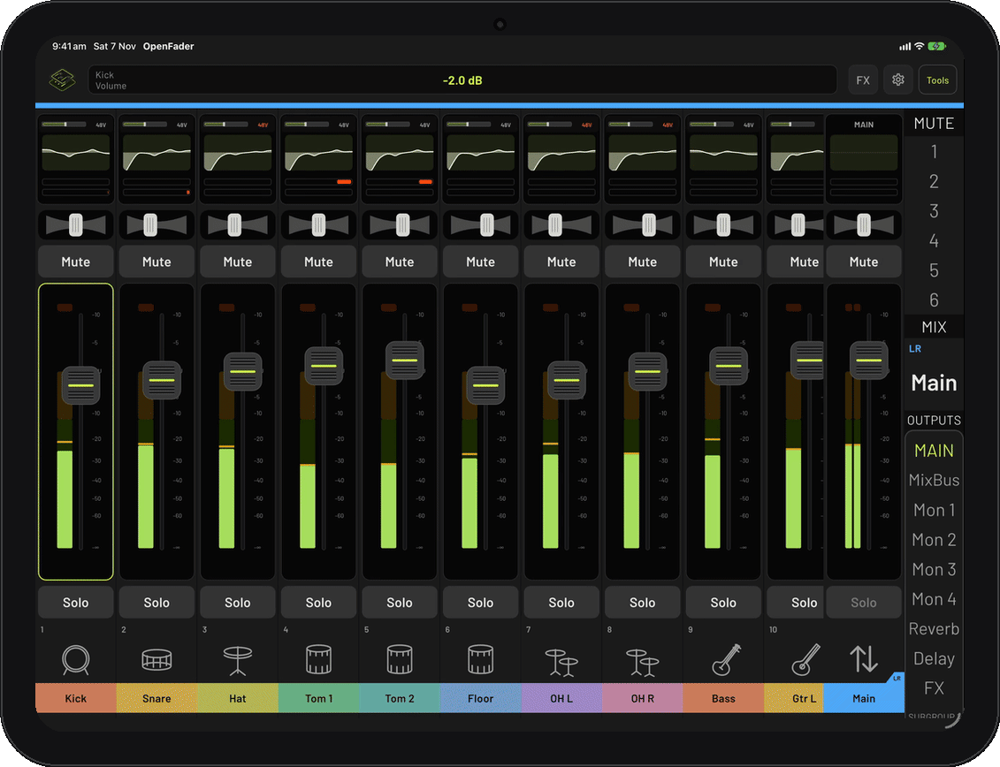
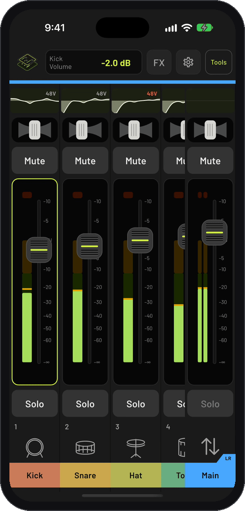

  

<h1 align="center">OpenFader</h1>

Control your mixer from any device

OpenFader is a free, open-source app for controlling digital mixers. It supports the Behringer X Air series and Mackie DL32S.

Available for iPhone, iPad, Android, Mac, Windows and Linux.

  
  

## Contributing

Contributions are incredibly helpful and welcome. App feedback is also valuable: if something can be improved, please [open an issue](https://github.com/gladsonsam/OpenFader/issues).

## License

GPL-3.0. See [LICENSE](LICENSE).
