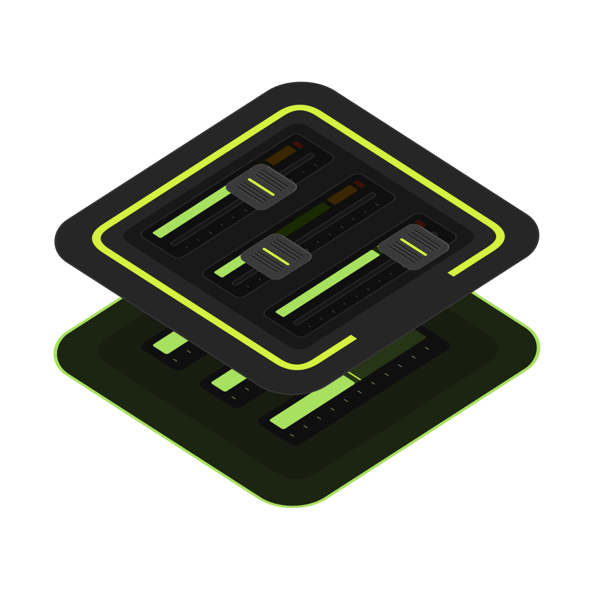

<p align="center">
  
</p>

<h1 align="center">OpenFader</h1>

<p align="center">One app to control your digital mixers.</p>

Currently supporting Behringer X-Air series and Mackie DL32S, with more consoles coming soon!.

## Development

The Flutter app is in `app/`; the Rust engine, mixer drivers, simulator, command-line client, and server are in `crates/`. Build scripts are in `scripts/`.

Requirements: Flutter 3.47.7, Rust stable, and Node.js 24 for version checks. Native builds also require the target platform's build tools.

Install Flutter dependencies and check the app:

```sh
cd app
flutter pub get --enforce-lockfile
flutter analyze
```

Run the remaining checks from the repository root:

```sh
node scripts/sync-version.mjs --check
cargo check --workspace --locked
cargo clippy --workspace --all-targets --locked -- -D warnings
cargo test --workspace --locked
```

## License

GPL-3.0. See [LICENSE](LICENSE).
